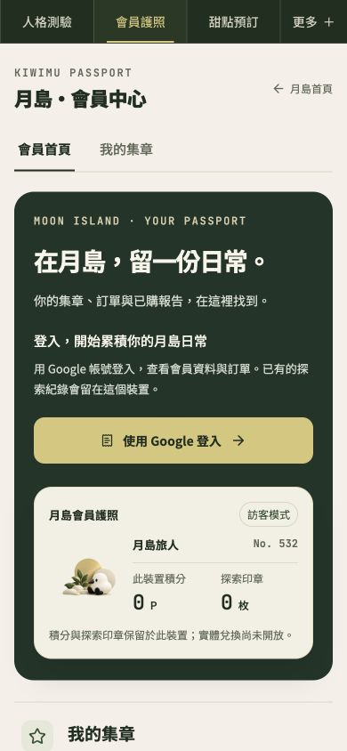
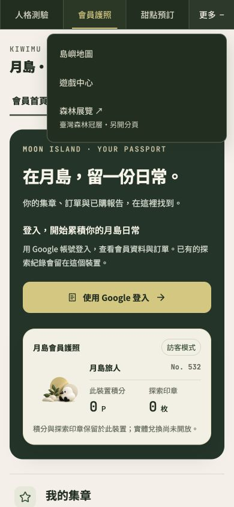
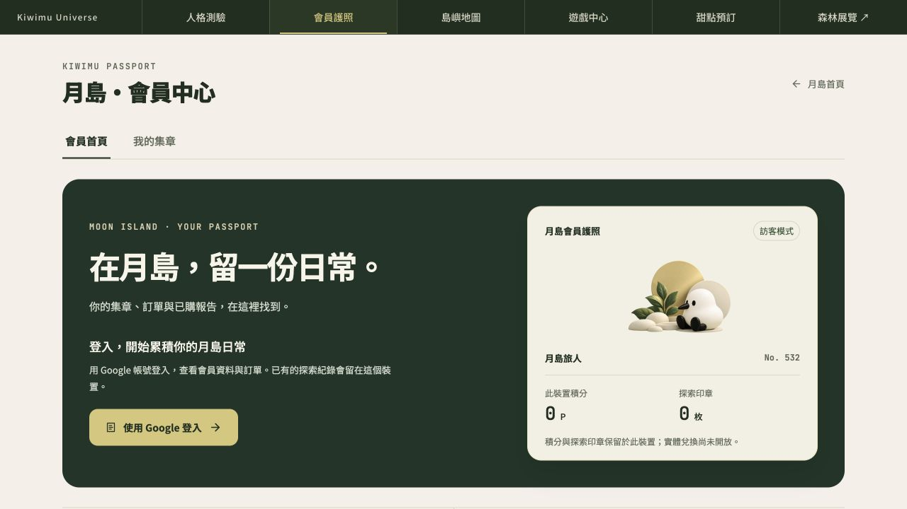
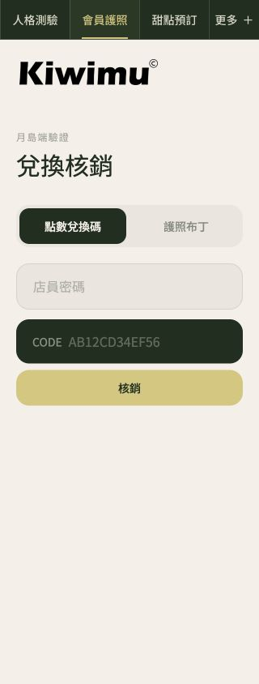

# Passport 森林導覽候選：2026-10-13

上方導覽改為森林深綠＋奶油白文字＋日光金目前站與焦點。手機保留人格測驗／會員護照／甜點預訂，地圖／遊戲／森林展覽收在更多；桌機按原五站順序接森林展示。

只先完成Passport候選，其他四站尚未同步。未production部署；新PR需Penso合併批准。

## 實際候選畫面

## 驗證與限制

- 正式build／tsc／既有OAuth、SSO、SW、reward、points guard、32旅程、5hydration通過；新增70實際source的rail URL／事件／cleanup斷言列入npm test。
- 隔離Chromium24案：四寬度320／390／768／1280×五頁20、320兩高度文字200%2、展覽popup fixture1、resize關閉1。所有案無pageerror／水平溢出，兩種核銷模式的按鈕均不越界；正式外部寫入0。
- 四寬度的五頁包含訪客landing、hub、核銷頁，以及/ passport／join的dummy讀取失敗頁；這些不是已登入會員或真實邀請簽收。
- 內建瀏覽器親看390／1280與more；Escape回焦、實測14px、森林rgb(31,47,31)與金rgb(215,198,120)、水平溢出0。核銷320實測column／overflow0，未填密碼或提交。
- 實作覆核APPROVE，獨立Reviewer另跑所有既有Node測試／tsc，11個effect fixture與5個mutation rejection通過。核銷修補只改六個className，AST排除className後與原版完全相同。
- Node hooks fixture不是React/DOM；Chromium與作者截圖不等於真人Safari／LINE／VoiceOver、Google登入／集章／點數／核銷成功驗收。
- 基線與初候選在320核銷页均12px溢出，來源為原submit button；本PR獨立排版commit改成手機上下排列，既有資料與handler維持。
