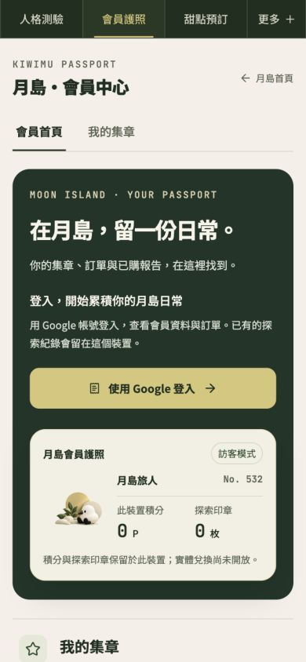
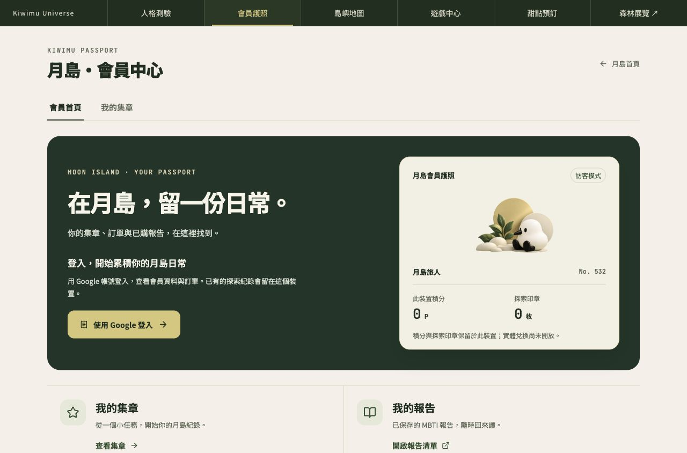
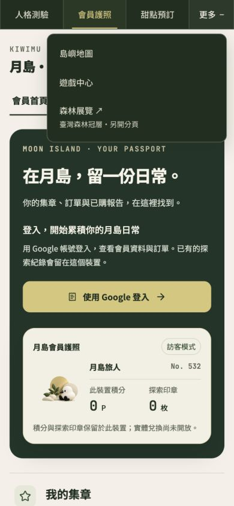

# Passport 導覽文字放大修補｜2026-10-13

已上線 PR #43 的設計保留。本候選只在「更多」按鈕加入 `flex-wrap: wrap`，使文字／全形加號放大時自然換行；不隱藏內容或放寬溢出斷言，不改會員／登入／核銷／積分。

MBTI 共用樣式的 CI 在 320px／200% closed More 重現 span right 320.53125px。修補後 MBTI 既有 accessibility 20案／V2 44案／reading 110案與4生成器通過；這些 MBTI 結果不稱為 Passport 完整流程驗收。

Passport build 與 OAuth／SSO／points-sync／32 journey／5 hydration／70 rail 回歸通過。五站最終 20 尺寸案無水平溢出，另有各站390px More開／關與 Escape，共10案；本站是其中4尺寸＋2 More案。作者 CUA 不是真人或獨立視覺簽收。

獨立程式增量覆核 APPROVE；runtime diff SHA256 `cf7b08c3ea2d23d1cb1c85595dbe6a9cd5edbca2cc28bf470402dd39869c8e3c`。尚未合併或 production 部署，需 Penso 另行批准新 PR。

